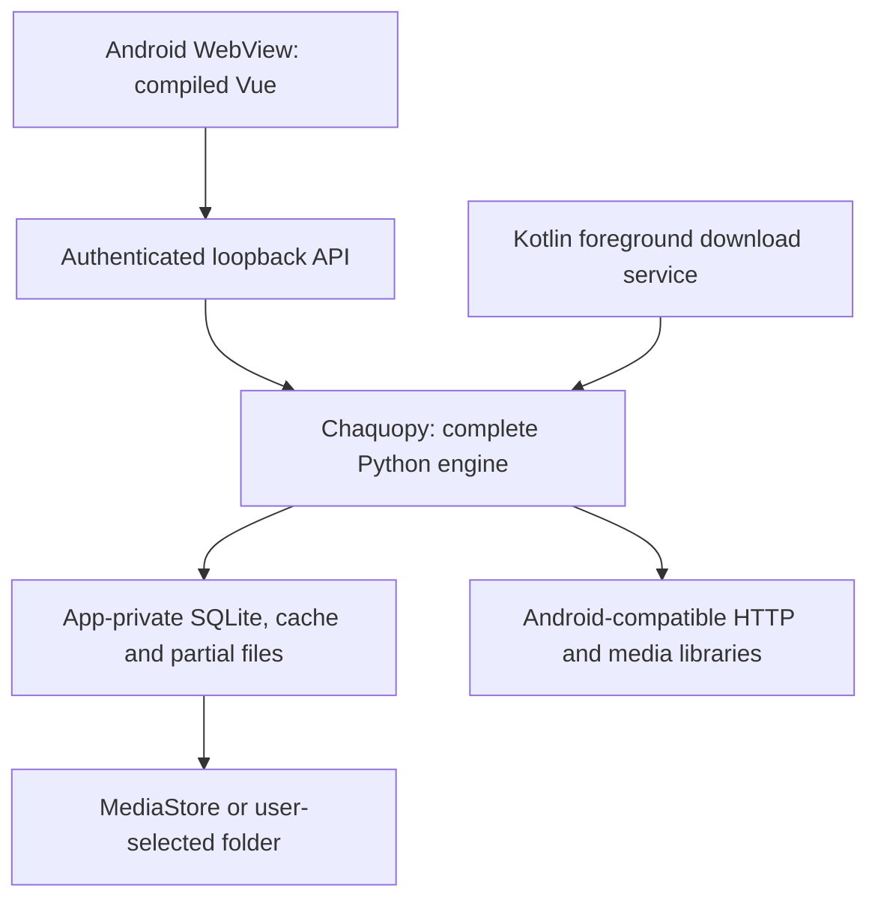

# Android: complete embedded Python engine and Vue interface

Status: the Android implementation and native dependency wheels are now in the
repository. APK/emulator validation and production signing are tracked by
`release-android.yml`; physical-device validation remains pending. See
[Android distribution](android-distribution.md) for the build and publication gates.

## Architecture to retain

Use the existing Kotlin Android shell, upgrade/validate Chaquopy, embed the same
Python application and the compiled Vue SPA, and display it in Android System
WebView. Keep a single Python download engine; Kotlin owns platform lifecycle,
notifications, storage access, verification windows and native media integration.
No Flutter rewrite or remote computer is required by this design.

## Initial gaps addressed by the implementation

The original Gradle project omitted Vue and required dependencies, started Python
from an Activity, targeted public file paths and signed releases with a debug key.
The implementation synchronizes Vue/backend resources, builds the missing native
wheels, uses JNI media/JCA AES adapters, authenticates a per-process loopback
server, adds foreground download notifications and MediaStore export, and gates
production publication on a dedicated signing identity and installed-app tests.
A successful Gradle build alone still does not establish real-phone reliability.

## Ordered route

### 1. Resolve native dependency feasibility first

Create a minimal Android dependency probe on `arm64-v8a` and `x86_64`. Verify
imports and real operations for curl_cffi/cffi and its native curl/TLS library,
cryptography, lxml, SQLAlchemy, Pydantic, websockets and yt-dlp. Align Python and
FastAPI with the desktop engine where Android wheels permit. Chaquopy supports
native requirements only when compatible artifacts are available; do not assume
desktop wheels work on Android. Python 3.12+ is a 64-bit path in its current
documentation. [Chaquopy configuration](https://chaquo.com/chaquopy/doc/current/android.html).

If a required wheel is missing, build and retain versioned Android wheels using
the NDK and the supported Python ABI, including cffi and the curl impersonation
library when needed. Test TLS certificates, profile behavior, cookies, streaming,
proxy authentication and cancellation on both ABIs. Do not silently substitute
ordinary HTTPX and declare protected-site compatibility equivalent. If this
dependency cannot be shipped reliably, decide on an explicit Android transport
adapter before progressing. This is the first decision gate.

### 2. Embed one source of backend and frontend

Build the SPA with `npm ci` and `npm run build`, then copy it into the APK assets
alongside versioned backend resources. Synchronize code from the repository at
build time rather than maintaining a diverging Android copy. Resolve template,
static and frontend paths through an Android resource adapter; extract only the
files that genuinely require filesystem paths into private application storage.
Open `/spa/` after a health check proving the local engine is ready. Test startup
without Wi-Fi: the interface and existing library must load without a remote server.

Start Python once per process, outside Activity recreation, and bind the API only
to `127.0.0.1` on an application-owned port. Authenticate requests with a per-run
secret and restrict WebView navigation. Preserve SSE/progress reconnect behavior.
Avoid exposing generic JavaScript-to-native execution to pages belonging to sites.

### 3. Implement Android media operations

The current engine invokes FFmpeg/ffprobe processes for inspection, mux and decode
verification. Desktop binaries cannot be copied into an APK and expected to run.
Android restricts executing binaries from writable application locations.
[Android execution restrictions](https://developer.android.com/about/versions/10/behavior-changes-10).

Prefer maintained NDK builds of the required FFmpeg libraries behind a narrow JNI
bridge. Python calls an Android `MediaTools` adapter for probing, remuxing,
subtitle merging and decoding checks; desktop keeps its subprocess implementation.
Validate codec coverage, cancellation, thread ownership, native alignment and
dependency licenses. Keep Range/HLS/subtitle orchestration in the Python engine.
Native Android codecs can complement playback, but do not automatically reproduce
subtitle muxing or the integrity checks of the current application.

### 4. Persist downloads through Android lifecycle

Introduce a Kotlin foreground service for user-started downloads, with progress,
pause and cancel notification actions. Keep the job queue in SQLite and checkpoint
partial transfers. Activity recreation only attaches another view to the same
engine. Handle process death by reopening the persisted queue and asking or
resuming according to the user's policy.

Select the background-work API and foreground-service type appropriate to the
target SDK and user-initiated transfer; account for modern restrictions/timeouts.
Use WorkManager for appropriate scheduled or recoverable background work rather
than treating a persistent Activity thread as guaranteed execution.
[Foreground-service types](https://developer.android.com/develop/background-work/services/fgs/service-types).

### 5. Adapt storage, browser verification and playback

Keep the database, `.part` files, HLS segments and cookie stores private to the
app. Publish completed media through MediaStore or a folder chosen through the
Storage Access Framework. Avoid assuming unrestricted writes to
`/storage/emulated/0/Download` on modern Android.
[Shared media storage](https://developer.android.com/training/data-storage/shared/media).

Use a separate verification WebView when supported, with domain-limited
CookieManager capture into the Python session. Test HttpOnly/expiry behavior and
the same proxy/network route. Custom Tabs or an external browser are fallbacks
for a manual visit; they do not automatically expose their private cookies.
Preserve the application's challenge state until a follow-up request succeeds.

Test HTML5/MSE or native HLS playback, fullscreen, subtitles, audio focus, seeking,
and return from the background. Restrict cleartext to the local engine as far as
the Android network policy permits; sources should use HTTPS. Limit WebView file
access and native permissions to actual application needs.

### 6. Validate, sign, then publish

Produce an arm64 device APK and an x86_64 emulator APK first, then a universal APK
if needed, plus an AAB when store distribution is desired. Store a release keystore
and its passwords in GitHub secrets; preserve the signing identity for updates.
The new release must not reuse the old debug signing configuration. Choose a
`versionCode` that remains monotonically increasing for supported installations,
even if the public semantic version series is reset to 0.x.

CI gates: engine import probe, built-SPA presence, offline cold start, SQLite
access, a real direct download and an AES-128 HLS fixture, interruption/restart,
subtitle mux/integrity checks, storage export, and service notification actions.
Run emulator instrumentation and real-device tests with screen off, rotation,
network loss, app restart and background restrictions. Record tested Android
versions/ABIs and publish checksums only after these gates succeed.

## Proposed milestones

1. **Native-dependency spike:** both ABIs import and execute essential HTTP/media operations.
2. **Offline embedded app:** current Vue and Python library load without a remote machine.
3. **Complete download path:** direct/HLS/subtitles work, with private storage and export.
4. **Lifecycle reliability:** service, notifications, pause/resume and process recovery pass.
5. **Signed beta:** installation/update and real-device matrix validated, then GitHub publication.

Estimate: a dependency probe of roughly 1–2 weeks, followed by 4–8 weeks for the
integration and validation if native dependencies are available. Custom curl/TLS
or media builds may substantially extend this. These are planning estimates,
not delivery commitments or evidence of completed Android support.
