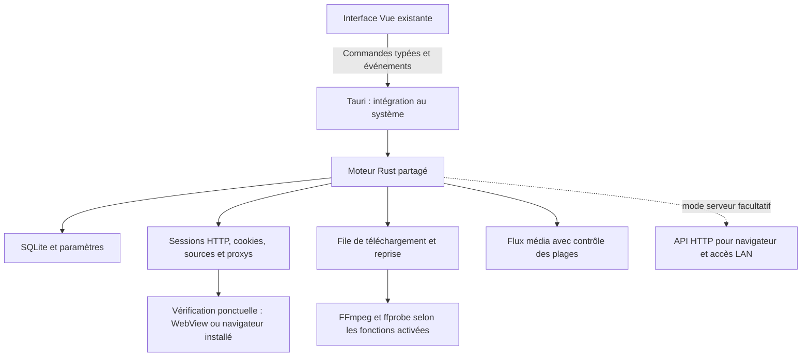

# Étude de migration d’Animan vers Tauri et Rust

Date : 14 octobre 2026. Base étudiée : commit `076e379`.

## Décision proposée

La migration est faisable et cohérente avec un objectif de petite application de bureau pour Windows, macOS et Linux. Conserver Vue 3, Pinia et l’interface actuelle, ajouter Tauri 2, puis remplacer progressivement le backend Python par un moteur Rust.

Une première version Tauri qui lance le backend Python peut valider l’intégration aux systèmes et faciliter la transition. Cette étape conserve le coût de Python et de ses dépendances. La réduction durable du poids nécessite que Python sorte du chemin d’exécution habituel.

Animan utilise déjà pywebview : le gain ne provient donc pas simplement du remplacement d’un navigateur embarqué volumineux. Tauri apporte une enveloppe de bureau et un backend compilé ; l’interface Vue reste du HTML/CSS rendu dans une WebView, avec des menus, dialogues, notifications et interactions système intégrables. Le choix ne transforme pas automatiquement les composants Vue en contrôles graphiques du système. [Architecture Tauri](https://v2.tauri.app/concept/architecture/).

L’étude comprend une inspection du dépôt et des documents officiels. Aucun prototype Tauri, paquet multiplateforme ou benchmark de mémoire n’a été produit. Les budgets et délais ci-dessous sont des objectifs ou des estimations de planification.

## État réel du dépôt

| Élément inspecté | Observation | Conséquence |
| --- | --- | --- |
| Backend suivi par Git | 66 fichiers Python, 17 607 lignes, incluant `run.py` et `desktop.py` | Une migration complète représente un chantier substantiel. Le nombre de lignes inclut commentaires et lignes vides. |
| Frontend suivi par Git | 43 fichiers Vue/TypeScript/CSS, 13 608 lignes | Réutiliser l’interface permet de concentrer le travail sur le moteur et ses transports. |
| Frontend compilé local | 31 fichiers, 1 744 770 octets, environ 1,74 Mo / 1,66 Mio, non compressés | L’interface seule n’est pas le principal obstacle à une petite distribution. |
| Téléchargements | `download_manager.py` : 3 142 lignes ; reprise directe, HLS, sous-titres, mux et vérification | Migrer une machine à états et ses garanties, pas uniquement une boucle HTTP. |
| HTTP commun | `source_http.py` : 716 lignes ; curl_cffi, cookies par domaine, profils, cache et rotation | La compatibilité avec les sources protégées doit être un critère de validation. |
| Extensions | Analyse heuristique des APK/DEX vers `SourceRecipe`, adaptateurs et extracteurs spécialisés | Animan n’exécute pas une machine virtuelle Android complète. Préserver cette frontière de compatibilité. |
| Persistance | SQLAlchemy et services utilisant directement SQLite, plus fichiers de cache/reprise | Préserver les schémas, chemins, versions VF/VO/VOSTFR et formats de fichiers temporaires. |
| Desktop actuel | pywebview + Uvicorn dans `desktop.py`, empaquetage PyInstaller | La WebView système est déjà utilisée quand disponible. |
| Distribution Windows | Le workflow construit Python ; le spec inclut templates/static, sans inclusion explicite de `frontend/dist` | La migration doit construire puis embarquer réellement la SPA, avec une validation du paquet livré. |
| Artefact local dans `dist/` | Un APK Android de 51 225 877 octets | Ce fichier ne constitue pas une référence de taille pour Windows/macOS/Linux. Aucun paquet desktop local comparable n’a été trouvé. |

La machine de développement possède Rust/Cargo, GTK 3 et WebKitGTK 4.1 détectables. Cela rend un essai Linux plausible ; cela ne valide pas l’édition de liens de Tauri, les autres dépendances de compilation ou les paquets Windows/macOS.

## Trois scénarios

| Scénario | Réutilisation | Intérêt principal | Limite |
| --- | --- | --- | --- |
| Tauri + backend Python auxiliaire | Presque tout le moteur actuel | Valider les fenêtres et les paquets rapidement | Python, Uvicorn et leurs bibliothèques restent livrés. Le poids peut augmenter pendant cette transition. |
| Tauri + moteur Rust, auxiliaires optionnels | Vue, données et contrats ; moteur réécrit par modules | Meilleur compromis proposé pour la distribution quotidienne | Les sources, téléchargements et intégrations média nécessitent des tests de parité. |
| Tauri + moteur Rust + tous les outils inclus hors ligne | Fonctionnalités immédiatement disponibles | Installation indépendante du téléchargement d’outils | FFmpeg, yt-dlp éventuel et dépendances système peuvent dominer la taille. |

Tauri sait empaqueter des exécutables auxiliaires, avec un binaire pour chaque système et architecture ciblés. Cela permet une transition Python ou un outil FFmpeg externe contrôlé. [Exécutables auxiliaires Tauri](https://v2.tauri.app/develop/sidecar/).

## Architecture cible

Séparer le moteur Rust de Tauri permet de le tester sans fenêtre et de conserver ultérieurement un mode serveur. Un petit serveur Rust de médias peut rester utile pour les playlists HLS, clés, sous-titres et requêtes Range. Remplacer Python n’oblige pas à supprimer tous les échanges HTTP locaux.

Le transport de contrôle change : `frontend/src/api/client.ts` utilise aujourd’hui des requêtes HTTP relatives et le store des téléchargements utilise `EventSource`. Introduire un adaptateur de backend avec les mêmes opérations métier, puis une implémentation Tauri. Les événements de progression transportent des états légers ; les vidéos passent par un flux/protocole média adapté, sans copie de fichiers entiers dans des messages JSON.

Le routage et les ressources demandent aussi une adaptation : la SPA possède actuellement une base liée à `/spa` ou `/app`, et des chemins `/api` et `/assets`. Prévoir un mode de routage compatible avec les ressources embarquées et une résolution explicite des URL. Tauri prend en charge les projets Vite. [Configuration Vite](https://v2.tauri.app/start/frontend/vite/).

Pendant la transition, chaque téléchargement, session HTTP et ensemble de données doit avoir un propriétaire unique. Éviter que Python et Rust téléchargent le même fichier ou possèdent simultanément deux sessions réseau pour la même source. Le backend Python auxiliaire doit être arrêté proprement lorsque ses tâches ont été transférées.

## Ce qui doit être conservé ou remplacé

| Fonction | Proposition | Difficulté estimée |
| --- | --- | --- |
| Vues, traductions, thèmes, recherche, préférences | Conserver Vue/Pinia ; adapter les appels au backend | Faible à moyenne |
| Fenêtre, notifications, dialogues, instance unique, fermeture | Intégration Tauri ; politique explicite de poursuite en arrière-plan | Moyenne |
| Bibliothèque, favoris, historique, paramètres | Accès SQLite Rust avec migration compatible | Moyenne |
| File de téléchargement | Modèle Rust indépendant de l’interface ; persistance des états | Élevée |
| Reprise directe | Conserver les règles Range/Content-Range, If-Range, ETag, chevauchement et publication atomique | Élevée |
| HLS | Conserver manifestes, segments atomiques, AES-128, reprises et renouvellement des URL | Élevée |
| Sous-titres et mux | Porter l’orchestration ; continuer à utiliser des outils média éprouvés | Moyenne à élevée |
| Sources préinstallées | Porter les requêtes et les parseurs à partir de fixtures HTML/JSON | Élevée |
| Extensions et APK | Porter l’analyse des recettes et leurs diagnostics ; conserver les limites explicites | Élevée |
| Vérification des sites | Fenêtre isolée, capture native des cookies et recours au navigateur | Élevée, variable suivant le système |
| Mode navigateur/LAN | API HTTP facultative autour du même moteur | Moyenne ; à traiter séparément du premier prototype |

Ne pas ajouter une JVM ou un environnement Android dans l’édition légère pour tenter d’exécuter toutes les extensions Aniyomi. Les recettes JSON et adaptateurs existants constituent une base plus compatible avec le budget. Un moteur d’extensions plus expressif demanderait sa propre étude : isolation, API autorisées, coûts mémoire et compatibilité ne sont pas acquis.

## HTTP, protections et vérification

Le client Rust doit préserver la continuité par domaine : cookies, expiration, proxy stable, profil cohérent, connections réutilisées, cache, regroupement des requêtes et temporisations. La nouvelle implémentation doit reconnaître les challenges et limitations avant l’extraction ou l’écriture du média.

`reqwest` fournit les fonctions usuelles d’un client HTTP Rust, mais sa documentation ne constitue pas une preuve de parité avec l’empreinte navigateur utilisée par curl_cffi. Pour les sources protégées, évaluer `wreq`, qui documente des profils de protocole, cookies, proxys et TLS via BoringSSL. Autre piste : conserver une bibliothèque curl adaptée derrière une interface Rust. Dans les deux cas, il existe des dépendances natives et un coût de compilation/maintenance. Un backend compilé en Rust n’implique pas que toutes ses bibliothèques soient écrites en Rust. [reqwest](https://docs.rs/reqwest/latest/reqwest/), [wreq](https://github.com/0x676e67/wreq).

Ne pas figer ce choix avant d’avoir comparé les mêmes scénarios et configurations : recherche, catalogue, extraction, redirection vers CDN, reprise, cookies et proxys. Un changement d’User-Agent seul n’établit pas la parité de transport. Mesurer également le poids ajouté par le client et ses bibliothèques.

Tauri expose des méthodes pour lire les cookies HTTP(S), y compris HttpOnly, ce qui permet d’envisager une fenêtre de vérification sans navigateur supplémentaire installé par Animan. Sur Windows, la lecture des cookies depuis certains contextes synchrones présente un risque de blocage documenté : utiliser le chemin asynchrone approprié. [API des cookies Tauri](https://docs.rs/tauri/latest/tauri/webview/struct.Webview.html#method.cookies_for_url).

La WebView ne remplace pas systématiquement un navigateur complet pour les protections. Cloudflare signale des limites pour les navigateurs embarqués et exige une adresse IP cohérente entre émission et résolution d’un challenge. Capturer un cookie ne garantit pas que le client HTTP sera accepté ensuite. Préserver une vérification manuelle ponctuelle dans un navigateur installé lorsque la fenêtre intégrée échoue. [Navigateurs pris en charge](https://developers.cloudflare.com/cloudflare-challenges/reference/supported-browsers/), [fonctionnement des challenges](https://developers.cloudflare.com/cloudflare-challenges/concepts/how-challenges-work/).

La configuration de proxy de la WebView doit être vérifiée sur chaque cible. WRY documente notamment macOS 14+ et une option `mac-proxy` pour ce chemin. La disponibilité réelle dépend des versions retenues et des fonctions exposées par Tauri. Sous proxy, ne pas proposer une capture intégrée qui utiliserait une autre route réseau. [Configuration de proxy WRY](https://docs.rs/wry/latest/wry/struct.WebViewBuilder.html#method.with_proxy_config).

La fenêtre d’une source distante doit rester isolée de l’interface de contrôle d’Animan : aucune permission de commande, accès aux fichiers ou lancement de processus accordée au site. Le transfert de cookies est exécuté côté natif pour le domaine autorisé, sans exposer le magasin complet à la page. [Permissions par fenêtre Tauri](https://v2.tauri.app/security/capabilities/).

## Vidéo et outils externes

Le lecteur actuel repose sur HTML5 vidéo et hls.js. Le conserver est pertinent, mais il faut tester les codecs et fonctions effectivement présents dans chaque WebView. hls.js nécessite MSE pour son chemin de lecture ; lorsque disponible, la lecture HLS native constitue un autre chemin. Tester plutôt que déduire la compatibilité du seul nom du système. [Documentation hls.js](https://github.com/video-dev/hls.js).

FFmpeg et ffprobe assurent aujourd’hui des fonctions distinctes : inspection, remux, fusion des sous-titres, assemblage et vérification par décodage. Porter l’orchestration en Rust ne rend pas ces outils inutiles. ffprobe fournit notamment une inspection structurée des flux. [Documentation ffprobe](https://ffmpeg.org/ffprobe.html).

Proposer deux modes de distribution :

- **Installation légère** : moteur principal, interface et client HTTP ; détection d’outils compatibles déjà installés, puis installation explicite d’un composant média vérifié si nécessaire. L’interface annonce clairement les fonctions qui ont besoin de ce composant.
- **Installation complète** : composants média livrés avec l’application, pour les fonctions disponibles hors ligne sans téléchargement supplémentaire. Mesurer et publier séparément son poids.

Ne pas supprimer les vérifications de fichiers ou les codecs requis pour obtenir artificiellement un petit paquet. Un build FFmpeg réduit doit couvrir les formats réellement promis par Animan. Le fallback yt-dlp actuel importe une bibliothèque Python : pour sortir Python de l’édition principale, il faudra soit le rendre auxiliaire optionnel, soit remplacer les cas d’extraction concernés. Son coût doit alors être compté dans l’installation complète.

## Contraintes par système

| Cible | Moteur de rendu | Distribution proposée | Point déterminant pour le poids et la compatibilité |
| --- | --- | --- | --- |
| Windows 10/11 x64 en premier | WebView2 | Installateur `.exe` ou `.msi` | Réutiliser le runtime présent ou l’installer à la demande. Tester une machine sans runtime et la distribution des outils média. |
| macOS Apple Silicon, puis Intel selon le besoin | WKWebView | `.app` / `.dmg`, builds séparés initialement | Tester lecteur et cookies, signer et notariser la distribution publique normale. Un paquet universel regroupe deux architectures. |
| Linux x64, base de compatibilité définie | WebKitGTK | `.deb` / `.rpm`, puis AppImage en option | Dépendances et codecs système ; test X11/Wayland. Le paquet utilisant les dépendances installées est plus petit que leur regroupement. |

Ces moteurs diffèrent selon le système. Leur coût mémoire et leurs codecs ne peuvent pas être déduits de la taille du seul binaire Rust. [Modèle de processus Tauri](https://v2.tauri.app/concept/process-model/).

La documentation Windows donne des ordres de grandeur de surcharge pour l’installation hors ligne de WebView2 : environ 127 Mo pour l’installateur embarqué et 180 Mo pour un runtime fixe. Ce sont des indications de la documentation, pas des mesures d’Animan. Une édition légère doit distinguer la taille de l’application des composants installés ou téléchargés séparément. [Installation Windows](https://v2.tauri.app/distribute/windows-installer/).

Sur Linux, Tauri avertit qu’un AppImage peut dépasser 70 Mo et qu’embarquer GStreamer pour la vidéo augmente encore son poids. Un petit `.deb` avec dépendances système et un AppImage autonome n’offrent donc pas le même coût total. Construire sur la plus ancienne base supportée, puis vérifier les versions de glibc et WebKitGTK. [Distribution AppImage](https://v2.tauri.app/distribute/appimage/).

Prévoir des builds et essais dédiés par système et architecture. Pour macOS, intégrer la signature et la notarisation au processus de publication. [Signature macOS](https://v2.tauri.app/distribute/sign/macos/).

## Budget et mesures

Viser initialement un cœur de distribution de **15 à 30 Mio par architecture**, hors WebView système et composants média optionnels. C’est un budget de conception à confirmer après compilation, pas une taille annoncée pour le produit terminé. Il faut le réévaluer si le transport de sites protégés ou les paquets système imposent davantage.

Publier quatre chiffres distincts : taille téléchargée de l’installateur, espace installé de l’application, dépendances supplémentaires et mémoire de l’ensemble de ses processus. Une réduction de l’installateur ne signifie pas une réduction identique de la RAM.

Les premiers leviers proposés sont de retirer Python du chemin habituel, de n’inclure que les fonctions Rust nécessaires, d’activer les optimisations de taille et de charger les outils à la demande. Tauri documente les profils Cargo et optimisations disponibles. Évaluer leur effet sur démarrage, comportement en erreur et débit avant d’adopter chaque réglage. [Optimisation de taille Tauri](https://v2.tauri.app/concept/size/).

Dans le moteur, limiter explicitement les buffers, queues et tâches concurrentes ; écrire les médias directement sur disque. Le proxy d’images actuel autorise 50 Mio de cache mémoire : c’est un budget à réévaluer indépendamment du langage. Éviter aussi un navigateur de vérification permanent et les actualisations de toutes les sources au lancement ; privilégier la source utilisée et un cache disque borné.

Le benchmark doit comparer la version actuelle et le prototype sur les mêmes machines et données :

| Scénario | Mesures |
| --- | --- |
| Démarrage à froid, puis à chaud | Temps jusqu’à l’interface utilisable et jusqu’aux données en cache |
| Repos avec accueil affiché | Mémoire totale du processus principal et des processus WebView ; CPU sur 60 secondes |
| Catalogue avec beaucoup d’affiches | Pic mémoire, chargement et défilement |
| Deux téléchargements directs + deux HLS | Débit, pic mémoire, taille des buffers, réactivité de l’interface |
| Interruption / redémarrage de l’application | Reprise byte-identique ou redémarrage sûr ; segments réellement retéléchargés |
| Lecture vidéo et fusion de sous-titres | Compatibilité, CPU et mémoire, en comptant les processus média |
| Vérification ouverte puis fermée | Libération des fenêtres/processus, cookies récupérés et résultat du nouvel essai |

Sous Linux, privilégier une mesure de mémoire partagée telle que PSS ; sous Windows et macOS, documenter la métrique employée. Ne pas additionner sans précaution des RSS qui peuvent compter plusieurs fois des pages partagées. Aucune économie de mémoire chiffrée n’est établie à ce stade.

## Migration et validation

| Étape | Livrable et condition de passage | Effort indicatif |
| --- | --- | --- |
| 1. Prototype de décision | Vue embarqué, lecture média, test du transport Rust, cookies et proxy sur les trois systèmes ; poids mesuré | 1–2 semaines |
| 2. Enveloppe de transition | Tauri avec backend Python auxiliaire, arrêt propre, chemins et paquets testés | 1–2 semaines |
| 3. Moteur Rust | Données, sessions HTTP et machine de téléchargement avec tests de parité et reprises | 6–10 semaines |
| 4. Sources et extensions | Adaptateurs, extracteurs, recettes APK et diagnostics ; couverture fonctionnelle déclarée | 4–8 semaines |
| 5. Distribution et optimisation | Migration utilisateur, signatures, benchmarks, paquets complets/légers et essais d’installation | 2–3 semaines |

Estimation pour une personne expérimentée travaillant à temps plein : environ **4 à 6 mois** pour une migration desktop complète et validée. Les étapes peuvent se chevaucher ; leur coût dépend surtout des sources et de la compatibilité média. Un prototype ou une enveloppe Tauri n’équivaut pas à cette migration complète. Les délais ne sont pas des engagements.

Le prototype doit particulièrement valider : le transport sur les sources effectivement utilisées, la lecture HLS/MP4 et des fichiers locaux, une récupération de cookies lorsque la vérification est proposée, le comportement sous proxy et l’absence de processus restant après fermeture. Si l’un de ces chemins est limité sur un système, définir le fallback utilisateur avant de généraliser.

Pour migrer les données, conserver ou importer les bases existantes depuis leurs chemins historiques, avec sauvegarde SQLite cohérente et migrations transactionnelles. Préserver les identifiants de tâches, chemins de vidéos, sous-titres, fichiers `.part`, métadonnées de reprise et répertoires de segments. Empêcher deux versions du moteur d’écrire simultanément les mêmes téléchargements. Valider le retour à une version précédente avant de modifier un schéma de façon incompatible.

Utiliser les tests Python comme spécification de comportement et leurs fixtures comme références, puis écrire les tests Rust correspondants. Les scénarios prioritaires incluent les variantes VF/VOSTFR/VO, l’absence d’écrasement, les plages invalides, le changement de représentation, les coupures HLS, la rotation après libération d’une connexion, les challenges, les limites de débit, les sous-titres partiellement réussis et les sorties de mux déjà existantes.

La décision recommandée est de lancer d’abord ce prototype ciblé, puis de choisir la stratégie de transport et de distribution sur ses résultats. La cible durable reste **Vue + Tauri + moteur Rust**, avec composants média et mode serveur séparément définis.
